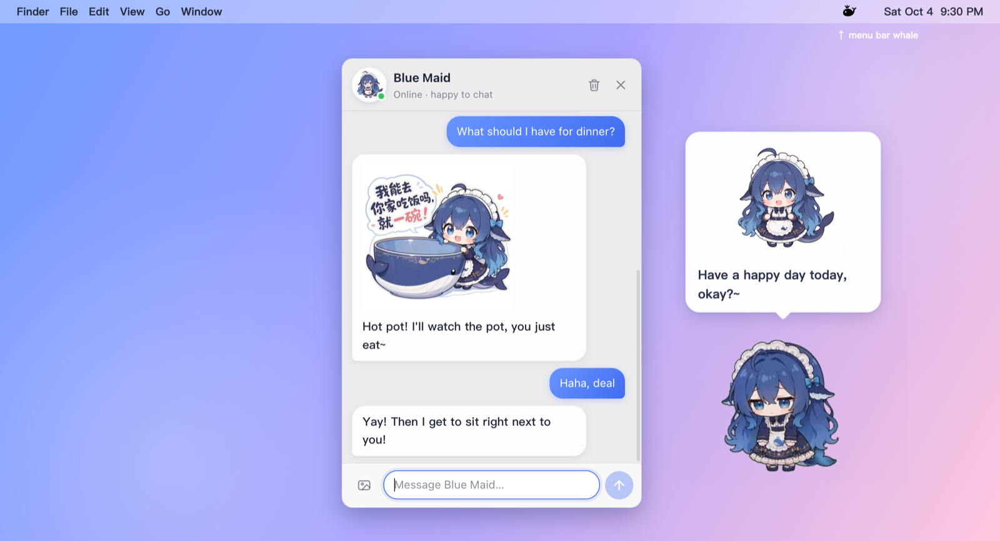
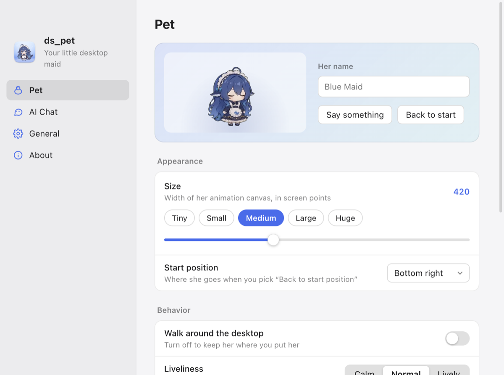

<p align="center">
  
</p>

<h1 align="center">ds_pet</h1>

<p align="center">
  A blue-haired maid who lives on your desktop (macOS and Windows). Drag her, fling her, let her chatter —<br>
  or chat with her and show her your pictures.<br>
  <a href="README.md">简体中文</a> · <b>English</b>
</p>

<p align="center">
  <a href="https://github.com/cjian1/ds_pet/releases/latest"><b>⬇︎ Download the latest release</b></a>
</p>

> [!NOTE]
> **ds_pet is a remix of [PC2005-cloud/dsh-pet](https://github.com/PC2005-cloud/dsh-pet).**
> The pet character, animations, artwork, physics and gameplay all come from the original project (MIT license). ds_pet turns it into a standalone desktop app for macOS and Windows and adds a chat panel, a settings window and a bilingual interface. Many thanks to the original author! See [NOTICE.md](NOTICE.md) for details.

<p align="center">
  
</p>

## Install

Download the right file from [Releases](https://github.com/cjian1/ds_pet/releases/latest):

| Your computer | Download |
|---|---|
| Mac with Apple silicon (M1 / M2 / M3 / M4…, most Macs from late 2020 on) | `ds_pet-<version>-arm64.dmg` |
| Mac with Intel | `ds_pet-<version>-x64.dmg` |
| Windows 10 / 11 (most PCs) | `ds_pet-<version>-win-x64-setup.exe` |
| Windows on ARM (Snapdragon and other ARM PCs) | `ds_pet-<version>-win-arm64-setup.exe` |

> Not sure? On a Mac, click  → About This Mac and look at "Chip" (requires macOS 12 or later).
> On Windows, open Settings › System › About; pick arm64 only if "System type" says "ARM-based processor" (requires 64-bit Windows 10 or 11).
> Rather not install anything? There's also a portable `ds_pet-<version>-win-x64.zip`: unzip it and double-click `ds_pet.exe` inside (the portable version can't update itself).

### macOS

1. **Install**: open the `.dmg` and drag ds_pet into the Applications folder.
2. **First launch**: double-click ds_pet in Applications. The app isn't signed with a paid Apple developer ID, so macOS stops it the first time. Allow it once:
   - If it says the developer can't be verified: click "Done", open **System Settings › Privacy & Security**, scroll down, click **Open Anyway**, then open ds_pet again.
   - If it says the app is "damaged": open Terminal, paste this line, press Return, then open ds_pet again:

     ```bash
     xattr -dr com.apple.quarantine /Applications/ds_pet.app
     ```

She'll appear in the bottom-right corner of your desktop, and a little 🐳 whale shows up in the menu bar.

### Windows

1. **Install**: run the `…-setup.exe` and click through. It installs just for you (into `%LOCALAPPDATA%\Programs\ds_pet`), needs no administrator rights, and adds ds_pet to the Start menu.
2. **Blocked the first time**: the app has no paid code-signing certificate, so Windows says "Windows protected your PC". Click **More info** → **Run anyway**; it won't ask again.

She'll stand on the taskbar in the bottom-right corner of your desktop, and a little whale appears in the taskbar corner (Windows 11 tucks new icons away: click ^ to find it, or drag it onto the taskbar to keep it visible).

### Want to chat? Pick an AI provider

The first time you open the app, Settings opens for you. Under **AI Chat**, pick a provider, paste its API key and click **Save** (it tests the key first and picks a model for you). The default is [DeepSeek](https://platform.deepseek.com/api_keys).

| Provider | Notes |
|---|---|
| **DeepSeek** (default) | Image input, thinking level, balance reports |
| OpenAI | Thinking level |
| Claude (Anthropic) | Uses Anthropic's own API |
| Google Gemini | Thinking level |
| Moonshot Kimi · Zhipu GLM · Qwen · SiliconFlow · OpenRouter | Just add a key |
| Doubao (Volcengine Ark) | Put your endpoint ID or model name in the model field |
| Ollama (local models) | No key needed; nothing leaves your computer |
| Custom endpoint | Any OpenAI-compatible or Anthropic-compatible API (LM Studio, relay services, …) |

Each provider keeps its own key, base URL and model, so switching back and forth loses nothing. To go through a proxy or relay, just change the base URL.

No key? You can still drag her, fling her, poke her and play 100+ animations — none of that needs the internet.

The interface follows your system language. To switch, go to Settings → General → Language. In English mode she talks to you in English too.

## How to play

| Action | What happens |
|---|---|
| Hold and drag her | Move her anywhere, even to another display. She **remembers where you leave her** |
| Flick while dragging | She flies off, bounces off the screen edges and lands with a squish |
| Click | Pat her head — she reacts |
| **Right-click** | Chat, say something, show her a picture, check balance, play animations, resize, hide, settings, quit |
| Drop a picture on her | She tells you what it is, then asks what you'd like her to do |
| Menu bar 🐳 icon (Windows: taskbar corner) | Show/hide, chat, size, random chatter, open at login, settings, quit |
| **⌃⌥P** (Windows: **Ctrl+Alt+P**) | Show/hide her from any app (handy for meetings and screen sharing; change it in Settings) |

Clicking or dragging her won't pull focus from the app you're using. Clicks on the transparent area around her go straight through to the windows below.

**The chat panel** sits right next to her. Replies stream in word by word, often with a sticker. Press Enter to send and Shift+Enter for a new line. You can paste a screenshot with ⌘V (Windows: Ctrl+V) to show her, and Esc closes the panel.

## Settings

Right-click her → **Settings…**, or click the whale in the menu bar (Windows: taskbar corner) → **Settings…**. Changes apply **immediately**.

<p align="center"></p>

- **Pet**: name, size, start position, walking around, liveliness, fling strength, random chatter (frequency and stickers), balance reports
- **AI Chat**: provider, API key, base URL, model (pick from the list or type one), thinking level, how many messages she remembers, clear chat history, personality
- **General**: language (match system / 简体中文 / English), open at login, Dock icon and show over full-screen apps (these two are macOS only), show/hide shortcut
- **About**: version, check for updates / one-click update, check for updates automatically

## FAQ

<details>
<summary><b>She's in the way of things I want to click.</b></summary>

Only her body catches clicks; the transparent area around her passes clicks through. If she's still in the way, right-click → <b>Size</b> to make her smaller, or press <b>⌃⌥P</b> (Windows: <b>Ctrl+Alt+P</b>) to hide her (press again to bring her back).
</details>

<details>
<summary><b>Is my API key safe? Will this cost a lot?</b></summary>

The key is stored only on your computer (macOS: <code>~/Library/Application Support/ds_pet/settings.json</code>, readable only by your user account; Windows: <code>%APPDATA%\ds_pet\settings.json</code>) and is only ever sent to the provider you chose. The app has no analytics or telemetry.<br>
Random chatter happens once every 15 minutes by default, and stops while you're away from your computer for more than 5 minutes. To use less credit, lower the frequency or turn chatter off in Settings.
</details>

<details>
<summary><b>Does she drain the battery?</b></summary>

While she's on screen, the main cost is playing her animation videos. When she's hidden (<b>⌃⌥P</b>) or the screen is locked, animation, chatter and balance checks all pause. If you're away from your computer for more than 5 minutes, she finishes what she's doing and rests without playing anything; touch the keyboard or mouse and she wakes up.
</details>

<details>
<summary><b>How do I update to a new version?</b></summary>

Settings › About → **Check for updates** → **Update now**. When a new version is out she'll also tell you, and the menu bar whale and her right-click menu get a **⬆︎ Update to x.y.z** item: one click does it.<br>
It downloads the installer for your Mac's chip from GitHub (about 200 MB), verifies it, replaces the app and restarts. Your settings and chat history are kept. ds_pet has to be in your Applications folder and you need permission to replace it; if not, Settings tells you why, and you can download it manually from <a href="https://github.com/cjian1/ds_pet/releases/latest">Releases</a>.<br>
On Windows, the installer version (installed with the setup.exe) updates in one click: it downloads the new installer, installs it quietly after quitting, and opens again. For the portable version, download the new zip from Releases.<br>
"Check for updates automatically" only asks GitHub whether there's a new version. It just lets you know and never installs anything by itself; you can turn it off in Settings › About.
</details>

<details>
<summary><b>She talks too much / too little.</b></summary>

Settings → Pet → <b>Chatter frequency</b> and <b>Liveliness</b>.
</details>

<details>
<summary><b>How do I quit or uninstall?</b></summary>

Quit: right-click her → <b>Quit ds_pet</b>, or menu bar whale → <b>Quit</b>.<br>
Uninstall on macOS: turn off <b>Open at login</b> in Settings → General, quit, then move ds_pet from Applications to the Trash. To remove your data too, delete <code>~/Library/Application Support/ds_pet</code>.<br>
Uninstall on Windows: find ds_pet in Settings › Apps › Installed apps and uninstall it; it asks whether to delete your settings and chat history too. For the portable version, quit and delete its folder; your data is in <code>%APPDATA%\ds_pet</code>.
</details>

<details>
<summary><b>Can I replace her animations?</b></summary>

Put a <code>.webm</code> with the same file name into <code>~/Library/Application Support/ds_pet/animations/</code> (Windows: <code>%APPDATA%\ds_pet\animations\</code>) and it will be used instead (see <code>desktop/assets/webm/</code> for the names).
</details>

<details>
<summary><b>Why are the stickers in Chinese?</b></summary>

The stickers come from the original artwork of dsh-pet. Her words follow your language setting, but the text drawn inside the sticker images stays as it is.
</details>

<details>
<summary><b>How is the Windows version different?</b></summary>

Same features: chat, pictures, chatter and one-click updates are all there. A few things follow Windows conventions: the whale icon lives in the taskbar corner, the shortcut is <b>Ctrl+Alt+P</b>, and she always stays on top (there are no "Show over full-screen apps" or "Dock icon" settings).<br>
Also, the menu you get by right-clicking her doesn't close with Esc; click anywhere else instead. She never takes focus away from the window you're using, so the keyboard stays with that app. Requires 64-bit Windows 10 or 11.
</details>

## Run from source

Requires [Node.js](https://nodejs.org/) 20 or later.

```bash
git clone https://github.com/cjian1/ds_pet.git
cd ds_pet
npm install
npm start
```

The first `npm start` downloads Electron automatically (about 100 MB).

Build installers:

```bash
npm run dist          # this Mac's architecture → dist/ds_pet-<version>-<arch>.dmg
npm run dist:all      # both Apple silicon and Intel
npm run install-app   # build and install straight into Applications
```

Builds only use tools that ship with macOS (`ditto` / `codesign` / `hdiutil`); no Apple developer account needed.

Build the Windows version (works on macOS, Linux and Windows):

```bash
npm run dist:win      # x64 + ARM → dist/ds_pet-<version>-win-<arch>-setup.exe plus a portable .zip
```

The installer is made with [NSIS](https://nsis.sourceforge.io/) (macOS: `brew install makensis`; Windows: `choco install nsis`); without it only the portable zip is built. The exe's icon and version info are written with [resedit](https://github.com/jet2jet/resedit-js), so no Wine is needed.

Tests:

```bash
npm run check             # syntax check
npm test                  # unit tests (settings, AI provider requests and streaming, local service, click-through, strings and assets)
npm run test:real-input   # drive the pet with the real system mouse (click, click-through, drag, right-click, image drop, fling)
npm run test:real-input:win   # the same on Windows, plus: clicking or dragging her never steals focus, Ctrl+Alt+P, --quit
npm run test:update       # one-click update end to end: build, then go old version → download → replace → restart as the new one in a temp folder
npm run test:update:win   # Windows: silent install of an old version → one-click update → login item → uninstall (uses the real install location; run it on a VM or CI)
```

`npm test` doesn't start Electron; GitHub Actions runs it before building a release. `test:real-input` takes over the mouse for about
half a minute and needs Accessibility permission for your terminal (System Settings › Privacy & Security › Accessibility). It runs the
dev build with a temporary data folder, so your settings and chat history are left alone.

<details>
<summary>Project layout</summary>

```
desktop/                 The app itself (copied into the .app as is; into resources\app on Windows)
  main/                  Main process: menu bar, windows, shortcut, login item, AI calls (providers.js lists the providers), storage
  pet/                   Pet page: animations, drag & fling physics, speech bubbles (from dsh-pet)
  chat/                  Chat panel
  settings/              Settings window
  i18n/                  Chinese and English strings
  assets/                106 animations, stickers, font, default config (from dsh-pet)
  resources/             App icon, menu bar icon (.icns / template images), Windows icons (.ico)
scripts/
  build-mac.sh           macOS build script (--dmg / --arch arm64|x64 / --install)
  build-win.mjs          Windows build script (--arch x64|arm64|all; installer + portable zip)
  win-installer.nsi      Windows installer (NSIS); win-readme.txt ships with the portable zip
  make-icons.js          Regenerate icons (npm run icons)
  dmg-readme.txt         Read-me included in the disk image
  debug/                 Small debugging tools (inspect pages, screenshots, real-mouse tests real-input.mjs + mouse.swift, and win-real-input.mjs + mouse.ps1 for Windows)
test/                    Unit tests (node --test, no Electron needed)
.github/workflows/       Runs the tests, then builds and publishes to Releases when a version tag is pushed
```

`npm run dev` starts with debugging ports open: main process on 9334, pages on 9333. When you add interface text, put both the Chinese and English versions into `desktop/i18n/i18n.js`.
</details>

### Releasing a new version

1. Bump `version` in `desktop/package.json` (for example `1.0.1`).
2. Update the "更新 / What's new" section at the top of `.github/release-notes.md` (one Chinese and one English line per item; the one-click update in Settings shows this section).
3. Commit, then tag and push: `git tag v1.0.1 && git push origin main v1.0.1`.
4. GitHub Actions runs the tests on macOS and Windows, builds the Mac (Apple silicon / Intel) and Windows (x64 / ARM) versions, and publishes them together to Releases. Installed copies offer **Update now** in Settings › About and in the menus.

## Credits & license

- **Original project**: [PC2005-cloud/dsh-pet](https://github.com/PC2005-cloud/dsh-pet) (MIT). The pet character, animations, artwork, physics and gameplay come from the original project, and the character and artwork copyright belongs to the original authors. The original license is kept in [`desktop/LICENSE.dsh-pet`](desktop/LICENSE.dsh-pet); see [NOTICE.md](NOTICE.md) for details.
- **This project's** code is released under the [MIT](LICENSE) license.
- Chat is powered by the AI provider you choose ([DeepSeek](https://platform.deepseek.com/) by default). This is a personal project and is not affiliated with any provider.
